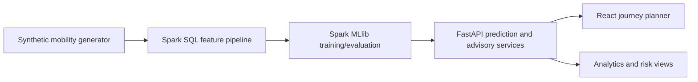

# Smart Mobility: Predictive Traffic Analytics for Bengaluru

An academic decision-support prototype that predicts traffic risk for an upcoming journey, compares candidate corridors, recommends a route, and produces an operational advisory for traffic authorities.

> **Data integrity:** the included mobility records are synthetic simulation data. OSRM/Nominatim integrations are optional and are not live traffic sources. The application must not be interpreted as a navigation service or a guarantee of future travel time.

## Architecture



```text
Synthetic Mobility Simulation
        ↓
Spark SQL Processing
        ↓
Feature Engineering
        ↓
Spark MLlib
        ↓
Future Scenario Prediction
        ↓
Travel Surge Analysis
        ↓
Corridor Risk
        ↓
OSRM Candidate Routes
        ↓
Prototype Route-Corridor Association
        ↓
Congestion-Aware Route Recommendation
        ↓
Authority Advisory
```

## Run on Windows 11

### Backend

```powershell
py -3.11 -m venv .venv
.\.venv\Scripts\Activate.ps1
pip install -r backend\requirements.txt
$env:HADOOP_HOME="$PWD\tools\hadoop"
$env:PATH="$env:HADOOP_HOME\bin;$env:PATH"
$env:PYSPARK_PYTHON=(Get-Command python).Source
$env:PYSPARK_DRIVER_PYTHON=$env:PYSPARK_PYTHON
$env:ALLOW_DEVELOPMENT_FALLBACK="false"
python spark\generate_mobility_data.py --rows 250000
python spark\preprocess.py
python spark\analytics.py
python spark\train_model.py
uvicorn backend.app.main:app --reload
```

The API starts at `http://localhost:8000`; Swagger is available at `/docs`. Spark scripts run in local mode and do not require HDFS. The API uses the persisted Spark model under `models/spark_best`. The default is fail-closed: `ALLOW_DEVELOPMENT_FALLBACK=false`. For UI-only development, explicitly set it to `true`; responses then identify `prediction_source=development_fallback`.

### Frontend

```powershell
cd frontend
npm install
npm run dev
```

Open the Vite URL shown in the terminal. Set `VITE_API_URL` if the backend is not on `http://localhost:8000`.

Supported runtime: **Python 3.11 + PySpark 3.5.4**. Python 3.12 is not the verified inference runtime for this project. On Windows, download a matching Hadoop `winutils.exe` and `hadoop.dll` into `tools\hadoop\bin` if Spark reports that `HADOOP_HOME` is missing. This is only a local filesystem compatibility helper; HDFS is not required.

For Hadoop 3.3.5, the setup commands are:

```powershell
New-Item -ItemType Directory -Force tools\hadoop\bin
curl.exe -L https://github.com/cdarlint/winutils/raw/master/hadoop-3.3.5/bin/winutils.exe -o tools\hadoop\bin\winutils.exe
curl.exe -L https://github.com/cdarlint/winutils/raw/master/hadoop-3.3.5/bin/hadoop.dll -o tools\hadoop\bin\hadoop.dll
```

## Data science workflow

The generator creates synthetic corridor, direction, calendar, weather, roadwork, incident, demand, speed, capacity and congestion fields designed to reproduce weekend, festival, holiday, directional and corridor-level patterns. `spark/preprocess.py` uses Spark SQL to derive cyclical hour features and historical corridor aggregates. `spark/train_model.py` compares logistic regression, decision tree and random forest classifiers with chronological train/validation/test splits and saves the selected Spark model and metrics under `models/`.

The API constructs a **new** future feature vector from the requested scenario. It does not look up a matching historical row. When no trained Spark model exists, the fallback predictor uses the same features and a documented logistic-style score so local demos remain usable.

## Product flow

1. Enter an upcoming date, time, journey, and optional festival/holiday/weather/roadwork inputs.
2. `/api/route/recommend` requests automatic OSRM alternatives and relevant configured Bengaluru exit-corridor waypoint candidates, then verifies, deduplicates, and evaluates the returned road-network geometries. If OSRM returns one verified route, the API returns one route; it never fabricates alternatives.
3. `/api/advisory` applies deterministic high/medium/low operational rules to the same predictions.
4. Analytics endpoints expose Spark-generated aggregates for the charts.

## Limitations

- Synthetic data is for demonstrating an analytical pipeline, not measuring actual Bengaluru traffic.
- OSRM duration is a base map duration, not a traffic observation.
- Nominatim place results are constrained to India and semantically validated before OSRM routing; routing responses expose the selected geocoding details.
- Journey endpoints can be entered as arbitrary Karnataka localities, landmarks, streets, or addresses, searched through the API, selected on the Leaflet map, or set from browser geolocation after explicit user permission. Selected coordinates are sent to FastAPI as `[latitude, longitude]` and take precedence over a second name lookup.
- Browser geolocation requires a secure context (HTTPS or a browser-approved localhost context). Permission denial, unavailable position, and timeout errors remain visible in the journey form.
- Predictions are scenario estimates and are not guaranteed.
- Route alternatives depend on public OSRM coverage and the configured destination-to-exit mappings; fewer than three genuine alternatives may be returned.
- Corridor evidence is recomputed for every returned route: OSRM step road names produce matched corridors, nearby configured representative points are shown as approximate only, and routes without reliable evidence are explicitly unmatched. Approximate or unmatched corridors are not used as route-specific Spark prediction inputs.
- Route analysis exposes both a general citywide advisory and a route-scoped advisory for each returned route. The Authority Advisory card follows the selected route's matched corridor evidence; it does not choose the highest-risk unrelated corridor from the citywide list.
- Festival and holiday flags are derived from the selected date and `config/festivals.json`. Weather is an explicit scenario input, with `Unknown` available when no weather condition is known. Congestion remains a synthetic Spark scenario estimate, not observed traffic.
- Journey analysis supports `Manual scenario` and `Calendar-derived` modes. Manual mode preserves the Festival and Holiday checkbox values with `manual_scenario_input` provenance; Calendar-derived mode disables those controls and resolves them from the selected date in `config/festivals.json`.
- Exit-corridor candidates currently cover Tumkur Road/Gorguntepalya, Western ORR via Nayandahalli/Sumanahalli, Mysore Road/Kengeri, Hosur Road/Electronic City, Bellary Road/Hebbal, and Whitefield Road/Hoskote. A candidate is requested only when destination or origin text matches its configured keywords.
- Candidate geometries are compared by normalized road-segment overlap. A waypoint route that follows the same road segments as an accepted route is reported and rejected as a duplicate rather than shown as a separate alternative.
- A verified waypoint candidate contributes its configured corridor as route evidence; approximate nearest-point matching may add one nearby corridor, but it cannot replace the validated gateway corridor.
- If OSRM cannot return a route, the API reports a routing error rather than presenting fabricated route geometry.
- Route-corridor association uses approximate representative corridor geometry; it is not GPS-level road-segment matching.
- The returned severity score is an expected class-severity value, not a calibrated probability of HIGH congestion. Spark's actual `probability_high` is exposed separately when available.
- Reported model metrics demonstrate consistency with the synthetic simulation regime and should not be interpreted as real-world Bengaluru traffic prediction accuracy.
- Authority actions are deterministic prototype decision rules, not a learned ML policy.
# Smart-Mobility

