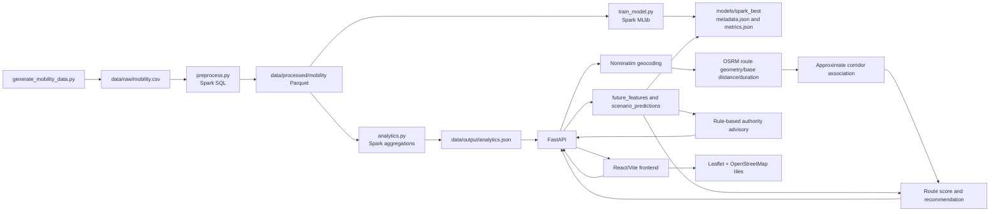

# Smart Mobility: Predictive Traffic Analytics & Congestion-Aware Route Advisory System for Bengaluru

## Evidence basis

This summary is based on the current source code, generated dataset, persisted model metadata and metrics, API schemas, frontend implementation, README, and tests in the project workspace. It does not claim features that were not verified.

Verified runtime and stack:

- Python 3.11.9 project virtual environment
- PySpark 3.5.4
- Apache Spark local mode (`local[*]`)
- FastAPI 0.115.6
- React and Vite
- Leaflet and React Leaflet
- OpenStreetMap tiles
- Nominatim geocoding
- OSRM routing
- Spark MLlib

The project is an academic predictive prototype using synthetic mobility simulation data. It is not a live-navigation or live-traffic system.

## 1. Project overview

### Exact title

**Smart Mobility: Predictive Traffic Analytics & Congestion-Aware Route Advisory System for Bengaluru**

### Problem statement

Urban congestion is affected by time of day, weekday/weekend patterns, festivals, holidays, weather, roadwork, incidents, corridor characteristics, and travel direction. A commuter or traffic authority benefits from seeing how a future scenario may affect congestion risk and route choice.

This project builds a scenario-based decision-support prototype. A user supplies a future journey scenario, the system constructs a new feature vector, applies a persisted Spark MLlib classifier, assesses the returned OSRM route against approximate configured corridors, and presents a route recommendation and rule-based authority advisory.

### Motivation and Bengaluru relevance

Bengaluru is a relevant setting because commuting peaks, technology-corridor travel, weekend departures, festival travel, and post-holiday return movement create different demand patterns. The project uses Bengaluru-oriented corridor names and a Bengaluru–Tumakuru demonstration, but its data is simulated rather than measured traffic.

The motivation is supported by the design of the simulator and analytics. The implementation demonstrates scenario handling; it does not prove that the measured patterns match actual city traffic.

### Main objective

To integrate Spark-based data processing and classification with future-scenario route assessment and an operational advisory interface.

### Specific objectives

1. Generate a repeatable mobility simulation containing corridor, direction, calendar, weather, roadwork, demand, capacity, speed, incident, and congestion fields.
2. Process the records with Spark SQL and persist a feature dataset.
3. Train and compare Spark MLlib multiclass classifiers.
4. Persist the selected model and metadata.
5. Convert a future user scenario into a new feature vector without looking up a historical row.
6. Retrieve real route geometry and base distance/duration from OSRM after Nominatim geocoding.
7. Associate route geometry with approximate configured corridor representative points.
8. Combine route information with predicted congestion severity.
9. Reuse scenario predictions for a rule-based authority advisory.
10. Present the workflow through FastAPI and a React/Vite frontend.

### Intended users

- Commuters or demonstrators comparing a future journey scenario.
- Traffic-management students and analysts examining scenario risk.
- Authorities in the prototype sense, through the advisory output.
- College evaluators reviewing a Big Data and ML integration.

The authority output is advisory only. It does not control signals, deploy personnel, or monitor live traffic.

### Scope

In scope:

- Synthetic mobility simulation
- Spark SQL preprocessing and analytics
- Spark MLlib classification
- Future scenario inference
- Nominatim place resolution
- OSRM route geometry/base route information
- Prototype corridor risk association
- Route scoring and recommendation
- Rule-based advisory
- React dashboard and map

Out of scope:

- Live traffic measurements
- GPS, camera, sensor, or toll data
- Guaranteed future travel time
- Signal control or automatic enforcement
- A production distributed cluster
- Calibrated real-world traffic forecasting

## 2. Problem definition

Weekends, festivals, holidays, commuting peaks, and return journeys can alter demand and direction. In the simulator, these conditions are represented as explicit fields and are used in generated demand and future feature construction.

Outbound and inbound patterns matter because the same corridor can have different operational implications depending on direction. The scenario context currently identifies:

- `OUTBOUND` for Friday/Saturday evening patterns
- `INBOUND` for Sunday/Monday return patterns
- `LOCAL` for other situations

The prototype attempts to answer:

> Given a future date, time, journey, and scenario factors, what congestion class does the persisted model assign to configured corridors, and what route-related advisory follows from those predictions?

It can construct scenario predictions, compare returned route records, and produce rule-based actions. It cannot observe current traffic, guarantee a future speed, or validate predictions against live Bengaluru measurements.

## 3. Existing approach and proposed approach

### Conventional/reactive framing

A simple reactive workflow may wait for a current incident or current route request and then display a route. A historical report may summarize past congestion but not convert a user-selected future scenario into a model input.

This comparison is conceptual; the project does not benchmark against a commercial navigation platform.

### Implemented approach

The project combines:

1. A repeatable simulated data pipeline.
2. Spark SQL feature preparation and analytics.
3. Candidate Spark MLlib classification.
4. A persisted selected model.
5. New future feature-vector construction.
6. External geocoding and route geometry.
7. Approximate corridor association.
8. A transparent heuristic route score.
9. A shared-prediction authority advisory.

The implementation is an integrated academic prototype, not evidence that it outperforms existing navigation systems.

## 4. System architecture



### Component responsibilities

- `spark/generate_mobility_data.py`: creates deterministic synthetic CSV records.
- `spark/preprocess.py`: reads CSV with Spark, derives features, writes Parquet.
- `spark/analytics.py`: creates aggregate JSON consumed by the API.
- `spark/feature_engineering.py`: defines the exact model feature list.
- `spark/train_model.py`: performs chronological splits, trains candidate classifiers, evaluates them, and persists the selected pipeline.
- `models/spark_best`: persisted Spark PipelineModel.
- `backend/app/services/prediction.py`: creates future features, loads the model, runs one-row Spark inference, and labels fallback explicitly.
- `backend/app/services/routing.py`: validates Nominatim results, calls OSRM, maps geometry to approximate corridor points, and scores routes.
- `backend/app/services/advisory.py`: creates rule-based actions from the same scenario predictions.
- `backend/app/main.py`: exposes FastAPI endpoints and combines route, predictions, and advisory.
- `frontend/src/main.jsx`: React pages, journey form, result cards, Leaflet map, prediction, advisory, and analytics views.
- `frontend/src/styles.css`: dashboard styling and responsive layout.

External services are Nominatim, OSRM, and OpenStreetMap tiles. They are not Spark data sources and do not provide the project's congestion prediction.

## 5. Dataset details

### Source and provenance

The dataset is generated locally by `spark/generate_mobility_data.py`. It is **synthetic**, not collected from Bengaluru sensors, GPS, cameras, tolls, or traffic authorities.

The current verified raw file is:

```text
data/raw/mobility.csv
```

Format: CSV with a header.

Verified dimensions:

- Rows: `250,000`
- Columns: `21`
- Date range: `2024-01-01` through `2026-12-31`
- Generation seed: `42`
- Default generator size: `250000`

### Raw columns

```text
date
hour
corridor
direction
day_of_week
is_weekend
is_friday
is_saturday
is_sunday
festival
is_festival
is_holiday
weather
roadwork
incident_count
traffic_volume
average_speed
road_capacity
travel_demand
congestion_index
congestion_level
```

### Generated assumptions

The generator cycles through dates, hours, and configured corridors. It derives:

- weekend and weekday flags from the generated date;
- festival and holiday flags from repeatable index rules;
- rain and roadwork from repeatable index rules;
- peak demand for hours 8, 9, 17, 18, and 19;
- corridor volume from baseline capacity, demand, and relative risk;
- incidents from a repeatable index rule;
- congestion from volume/capacity, incidents, roadwork, and rain;
- speed from baseline speed and congestion;
- `LOW`, `MEDIUM`, and `HIGH` labels from congestion thresholds.

The target is therefore generated by a known simulation rule. This is important when interpreting the very high model metrics.

### Target classes

The target column is `congestion_level`:

- `LOW`: congestion value below `0.42`
- `MEDIUM`: congestion value from `0.42` up to but excluding `0.67`
- `HIGH`: congestion value at or above `0.67`

The training script maps these labels to Spark numeric labels:

```text
LOW = 0.0
MEDIUM = 1.0
HIGH = 2.0
```

### Missing values and duplicates

The generator writes complete rows and does not intentionally create missing values. The inspected preprocessing script does not contain explicit missing-value imputation or duplicate removal. Spark reads the generated CSV using schema inference.

Exact post-generation duplicate analysis is not recorded in the current artifacts; do not claim that duplicates were removed.

### Processed dataset

`spark/preprocess.py` writes:

```text
data/processed/mobility
```

as Spark Parquet. It adds derived feature columns and historical corridor aggregates.

### Splits

The persisted metadata records chronological date periods:

- Training: `2024-01-01` to `2026-02-06`
- Validation: `2026-02-06` to `2026-07-20`
- Test: `2026-07-20` to `2026-12-31`

The exact boundary dates are generated from the ordered distinct dates using 70% and 85% positions. The final model is refit on the union of training and validation data before persistence; test data remains the reported holdout.

### Interpretation warning

Metrics on this dataset measure how well the model reproduces the synthetic data-generating process. They are not proven real-world Bengaluru traffic accuracy.

## 6. Big Data technologies and their actual use

### Apache Spark and PySpark

Spark is used in local mode with `master("local[*]")`. The project is not configured as a Hadoop cluster or cloud deployment.

Spark operations include:

- CSV reading with inferred schema
- column derivation
- trigonometric feature transformation
- windowed corridor averages
- Parquet writing
- grouped analytics
- chronological filtering
- model fitting and transformation

### Spark SQL/DataFrame processing

`preprocess.py` uses Spark DataFrame expressions to derive cyclical hour features, scenario flags, directional indicators, demand/capacity fields, and historical corridor aggregates.

`analytics.py` uses Spark groupings and aggregations for:

- hourly congestion
- weekday versus weekend congestion
- festival versus normal congestion
- direction
- Friday/Saturday outbound patterns
- Sunday/post-holiday inbound patterns
- day-type/hour
- corridor congestion, traffic volume, and speed

### Spark MLlib

Spark MLlib trains:

- Logistic Regression
- Decision Tree
- Random Forest

The selected persisted model is Logistic Regression. `VectorAssembler` produces the model input vector.

### Distributed-processing assessment

Spark APIs and local parallel execution are demonstrated. The current 250,000-row dataset is useful for an academic local prototype, but the project does not demonstrate production cluster scalability, fault tolerance, HDFS, or benchmarked distributed speedup.

## 7. Feature engineering

The exact model features are defined in `spark/feature_engineering.py` and recorded in `models/metadata.json`.

### Time and calendar features

- `hour_sin`: cyclical sine encoding of hour.
- `hour_cos`: cyclical cosine encoding of hour.
- `is_weekend`: weekend indicator.
- `is_friday`: Friday indicator.
- `is_saturday`: Saturday indicator.
- `is_sunday`: Sunday indicator.
- `is_pre_holiday`: Friday and holiday interaction used as a pre-holiday proxy.
- `is_post_holiday`: Sunday and holiday interaction used as a post-holiday proxy.

### Scenario/event features

- `is_festival`: festival indicator.
- `is_holiday`: holiday indicator.
- `is_rain`: derived from `weather == "Rain"`.
- `roadwork`: roadwork indicator.
- `incident_count`: incident count in training data; future inference uses `1.0` only when an `incident` field is supplied, otherwise `0.0`.

### Demand, capacity, and corridor features

- `travel_demand`: generated demand or future scenario demand.
- `traffic_capacity_ratio`: training traffic volume divided by road capacity; future inference uses demand multiplied by corridor relative risk.
- `corridor_risk_profile`: training preprocessing currently derives this from the same volume/capacity ratio; future inference uses configured corridor relative risk.

### Direction features

- `direction_outbound`: one/zero indicator.
- `direction_inbound`: one/zero indicator.

There are no categorical features in the persisted metadata and no one-hot categorical vector in the current pipeline.

### Target exclusion and leakage concern

The target `congestion_level` is mapped to `label` and is not included in the `FEATURES` list. However, the generated label is directly derived from congestion calculations involving variables closely related to the model inputs, especially demand, capacity ratio, incidents, roadwork, rain, and corridor risk. This synthetic dependency is a target-leakage-like limitation and helps explain near-perfect metrics and probability saturation.

## 8. Machine learning methodology

### Task

Multiclass classification with three classes:

```text
LOW, MEDIUM, HIGH
```

### Candidate algorithms

The training script evaluates:

- Logistic Regression: `maxIter=50`
- Decision Tree: `maxDepth=8`
- Random Forest: `numTrees=40`, `maxDepth=10`

### Selection

The selected model is the candidate with the highest validation F1. The saved metadata identifies:

```text
logistic_regression
```

### Workflow

1. Read processed Parquet.
2. Convert congestion class to numeric `label`.
3. Obtain ordered distinct dates.
4. Create chronological train, validation, and test frames.
5. Assemble the 18 features with `VectorAssembler`.
6. Fit each candidate pipeline on training data.
7. Evaluate validation and test predictions.
8. Select the best validation-F1 candidate.
9. Refit that pipeline on training plus validation data.
10. Save it under `models/spark_best`.
11. Save metrics and metadata JSON.

### Model loading and future prediction

`backend/app/services/prediction.py` loads the persisted `PipelineModel`. The API builds a new one-row DataFrame from `future_features()` and calls `model.transform(row)`.

The API does not retrieve a historical row as the prediction.

### Probability and severity

Spark returns a probability vector ordered by the model classes. The service calculates:

```text
severity_score =
  (0 × P(LOW) + 1 × P(MEDIUM) + 2 × P(HIGH)) / 2
```

This is an expected normalized class-severity score, not the probability of HIGH. `probability_high` is separately extracted from the HIGH class probability when available.

### Fallback behavior

The deterministic development fallback exists in the code but is disabled unless:

```powershell
$env:ALLOW_DEVELOPMENT_FALLBACK="true"
```

The default is fail-closed. With fallback disabled, model-loading or inference errors raise an explicit error. Fallback responses are labeled `development_fallback`; successful persisted-model responses are labeled `spark_mllib`.

## 9. Model evaluation

The saved metrics are in `models/metrics.json`. Metrics below are weighted multiclass metrics from the chronological validation and test splits.

### Candidate comparison

| Model | Validation accuracy | Validation F1 | Test accuracy | Test F1 |
|---|---:|---:|---:|---:|
| Logistic Regression | 0.999840 | 0.999839 | 0.999867 | 0.999867 |
| Decision Tree | 0.983392 | 0.983081 | 0.983945 | 0.983667 |
| Random Forest | 0.984168 | 0.983794 | 0.984716 | 0.984426 |

Additional saved Logistic Regression test metrics:

- Weighted precision: `0.999867`
- Weighted recall: `0.999867`

Saved Logistic Regression validation metrics:

- Weighted precision: `0.999839`
- Weighted recall: `0.999840`

### Confusion matrix and per-class metrics

The training loop computes a test confusion matrix in memory, but `metrics.json` deliberately omits the matrix during serialization. A persisted confusion matrix and per-class precision/recall are therefore **not available in the saved artifacts**.

### Interpretation

The Logistic Regression score is extremely high. This should be explained as consistency with the synthetic label-generation process, not as validated real-world accuracy. The project has no external Bengaluru traffic test set in the inspected artifacts.

## 10. Future-scenario prediction workflow

The user can configure:

- source place
- destination place
- date
- time
- festival
- holiday
- weather: `Clear`, `Cloudy`, or `Rain`
- roadwork

The backend validates the time and weather values with Pydantic.

For each configured corridor, `future_features()` computes:

- cyclical hour values
- weekday flags
- holiday/festival/weather/roadwork indicators
- demand from base demand, peak time, weekend, festival, and direction pattern
- corridor-specific capacity ratio and relative risk
- direction flags

The resulting feature vector is sent to the persisted Spark PipelineModel. `scenario_predictions()` predicts every configured corridor once per request. The route endpoint reuses these predictions in a cache.

This is scenario-based inference. It is not a live traffic forecast.

## 11. Route recommendation

### Geocoding

`backend/app/services/routing.py` queries Nominatim with contextual searches such as:

```text
<place>, Karnataka, India
<place>, India
<place>
```

The request is restricted to India with `countrycodes=in` and requests address details.

The result is accepted only when:

- the requested locality matches a city, town, municipality, village, county, or display-name first part;
- the country is India;
- the state is Karnataka.

The response includes name, latitude, longitude, display name, address, and `geocoding_source: "Nominatim"`.

### OSRM

The validated source and destination coordinates are sent to the public OSRM driving endpoint with:

- `overview=full`
- `geometries=geojson`
- `alternatives=true`
- `steps=false`

OSRM supplies route geometry, base distance, and base duration. It does not supply the project's congestion prediction and is not a live traffic source.

### Real routes only

The backend requests both automatic OSRM alternatives and relevant configured exit-corridor waypoint routes. It validates route endpoints, removes duplicate or near-identical geometries, and retains only genuine road-network routes. If only one route is verified, the API returns one route option.

The initial exit-corridor catalog covers Tumkur Road/Gorguntepalya, Mysore Road/Kengeri, Hosur Road/Electronic City, Bellary Road/Hebbal, and Whitefield Road/Hoskote. A gateway is requested only when the origin or destination matches its configured destination keywords; it is not forced onto unrelated journeys.

### Corridor association

For a route with geometry, the service converts OSRM `[longitude, latitude]` coordinates into `[latitude, longitude]` and compares every route coordinate with approximate representative points in `PROTOTYPE_CORRIDOR_POINTS`.

It selects the two nearest configured corridor points. This is a nearest-representative-point prototype method:

- it uses the full returned route coordinate list;
- it has no maximum distance threshold;
- it does not use actual corridor polylines;
- it is not GPS-level road-segment or GIS map matching.

### Route scoring

For each route, the highest associated corridor severity is used:

```text
adjusted_minutes =
  base_minutes × (1 + severity_score × 0.85)

score =
  adjusted_minutes
  + severity_score × 20
  + distance_km × 0.08
  + 10 if risk is HIGH
```

The lowest score is labeled `BEST ROUTE`. Other genuine OSRM routes are presented as alternatives; the UI does not label them with unsupported avoidance claims.

The adjusted duration is a prototype heuristic based on predicted severity. OSRM's base duration itself is not a traffic-adjusted future travel-time estimate.

## 12. Authority advisory

`backend/app/services/advisory.py` receives the same `scenario_predictions` list used by the route endpoint. It sorts corridors by severity and identifies HIGH-risk corridors.

Rules:

- HIGH: deploy additional traffic personnel, prepare a diversion route, issue a commuter advisory; roadwork and rain can add corresponding actions.
- MEDIUM: monitor corridor, prepare standby personnel, review diversion readiness.
- LOW: normal monitoring.

The advisory also produces counts, a summary, scenario factors, and a directional note.

The actions are deterministic rules, not ML-generated recommendations. The system does not automatically control signals or deploy personnel.

## 13. Frontend and demonstration

### Current interface

The React/Vite frontend in `frontend/src/main.jsx` provides:

- journey input page;
- traffic prediction page;
- authority advisory page;
- analytics page;
- future date/time, source, destination, weather, festival, holiday, and roadwork controls;
- model status indicator;
- route result card;
- route table;
- scenario factors and travel-surge display;
- advisory card;
- analytics charts.

### Map

The current map uses:

- `react-leaflet`
- `leaflet`
- OpenStreetMap tiles
- actual OSRM geometry returned by the backend
- source and destination markers
- automatic route bounds fitting

OSRM coordinates are converted from `[longitude, latitude]` to Leaflet `[latitude, longitude]` by the backend before the frontend renders them.

### Demonstration workflow

Use:

```text
From: Bengaluru
To: Tumakuru
Date: 17 October 2026
Time: 5:00 PM
Festival: Yes
Holiday: Yes
Weather: Rain
Roadwork: No
```

Then demonstrate:

1. Future journey input.
2. Travel surge and direction context.
3. New feature construction and persisted Spark inference.
4. Predicted congestion class and severity.
5. OSRM/OpenStreetMap route geometry.
6. Route score and recommendation.
7. Shared predictions in the authority advisory.
8. Synthetic analytics.

Runtime browser verification is not treated as proven merely by a production build. Capture a browser screenshot after starting the backend and frontend.

## 14. API design

The implemented FastAPI endpoints are:

| Method | Path | Purpose | Important request/response details |
|---|---|---|---|
| GET | `/api/health` | Report model and fallback status | Returns model availability, model type, prediction source, fallback status |
| POST | `/api/predict/scenario` | Predict configured corridors for a future scenario | Request includes date, time, source, destination, festival, holiday, weather, roadwork; response includes scenario context and predictions |
| POST | `/api/route/recommend` | Produce route recommendation | Returns recommended route, actual route options, geometry, geocoding metadata, scenario context, corridor predictions, and advisory |
| GET | `/api/corridors` | List configured corridors | Returns corridor names |
| GET | `/api/corridors/risk` | Run the default corridor-risk scenario | Returns default scenario, context, and predictions |
| POST | `/api/advisory` | Generate advisory for a supplied scenario | Returns ranked corridor advisory and actions |
| GET | `/api/advisory` | Generate advisory for the default scenario | Returns default advisory |
| GET | `/api/analytics` | Load Spark-generated analytics JSON | Returns provenance and aggregate series |

### Request validation

`ScenarioRequest` requires a date and `HH:MM` time pattern, validates clock ranges, and restricts weather to Clear, Cloudy, or Rain. Source and destination must be non-empty.

### Error behavior

- Invalid request data is rejected by Pydantic/FastAPI.
- Missing analytics returns HTTP 503.
- Geocoding errors from the route endpoint return HTTP 502.
- Spark model failure with fallback disabled raises an explicit inference failure.
- External OSRM failures are reported as routing errors; the service does not fabricate route alternatives.

## 15. Results and screenshots to capture

Recommended evidence:

1. `data/raw/mobility.csv` header and a few rows.
2. Spark preprocessing command and Parquet output.
3. Spark analytics output or the Analytics page.
4. `models/metadata.json` showing model type, features, classes, and periods.
5. `models/metrics.json` model comparison table.
6. `/api/health` with `model_available=true`, `prediction_source=spark_mllib`, and `fallback_enabled=false`.
7. `/api/predict/scenario` response showing prediction fields.
8. `/api/route/recommend` response showing real route geometry, geocoding metadata, route source, corridor predictions, and advisory.
9. Browser screenshot of the Leaflet map and recommended route.
10. Browser screenshot of the advisory card.

Still needs personal capture:

- A fresh browser screenshot with the current backend running.
- A terminal/API capture proving the demo request used `spark_mllib`.
- A screenshot of analytics charts.
- If the presentation discusses multiple OSRM routes, a separate request where OSRM actually returns more than one route; do not imply that alternatives always exist.

## 16. Advantages and contributions

- Integrates a complete Spark-to-API-to-frontend workflow.
- Uses Spark SQL/DataFrames for preprocessing and analytics.
- Uses persisted Spark MLlib inference rather than a normal-path formula.
- Builds a genuinely new future feature vector.
- Separates OSRM route/base-duration responsibility from Spark congestion prediction.
- Reuses scenario predictions for the authority advisory.
- Makes fallback mode explicit and fail-closed by default.
- Provides a reproducible synthetic-data academic demonstration.
- Makes model and data limitations visible rather than presenting simulated results as live traffic.

## 17. Limitations

1. The dataset is synthetic and generated from known rules.
2. Metrics are not externally validated Bengaluru traffic accuracy.
3. Synthetic feature/label dependencies may create leakage-like behavior and overconfident probabilities.
4. Nominatim and OSRM are external services and may be unavailable or rate-limited.
5. OSRM base duration is not live traffic duration.
6. The route-corridor association uses approximate representative points, not GIS road segments.
7. OSRM may return only one route for a journey; multiple alternatives are not guaranteed.
8. Route severity uses associated corridor maxima and heuristic weights.
9. Route alternatives depend on public OSRM coverage and the configured destination-to-exit mappings; routing failure is reported rather than replaced with fabricated routes.
10. The system runs locally and has no demonstrated production cluster scalability.
11. No external real-world holdout set, calibration study, or per-class saved confusion matrix is available.
12. Browser runtime evidence still needs to be captured separately from the successful production build.

## 18. Future enhancements

These are proposed, not completed:

- Replace simulation with validated historical traffic, toll-count, GPS, or sensor data.
- Add external validation and probability calibration.
- Store and report confusion matrices and per-class metrics.
- Replace representative points with corridor polylines or road-segment matching.
- Improve route-level aggregation and expose mapping confidence.
- Handle OSRM/Nominatim rate limits and failures with clearer provenance.
- Separate verified OSRM routes from unavailable or failed routing requests.
- Add a larger-scale distributed deployment and benchmark.
- Add automated browser tests for the Leaflet map and result presentation.

## 19. Conclusion

The project genuinely implements a local academic pipeline from synthetic mobility data through Spark SQL, Spark MLlib model persistence, future scenario inference, Nominatim geocoding, OSRM route retrieval, approximate corridor assessment, route scoring, FastAPI responses, and a React/Leaflet interface.

The strongest demonstrated path is:

```text
future scenario
→ new feature vector
→ persisted Spark MLlib model
→ congestion prediction
→ OSRM route geometry/base route data
→ approximate corridor assessment
→ route recommendation
→ same scenario predictions
→ authority advisory
```

The result is suitable for a college project demonstration when the presenter clearly states that the data and model evaluation are synthetic, OSRM is not live traffic, and corridor matching is prototype-level.

## 20. Viva preparation: 20 questions and answers

### 1. Why was Apache Spark used?

Spark provides DataFrame, SQL-style aggregation, Parquet, and MLlib APIs in one ecosystem. In this project it makes the preprocessing, analytics, and model workflow consistent. The current deployment is local mode, so it demonstrates Spark programming rather than a production cluster.

### 2. Why Spark MLlib?

Spark MLlib allows the classifier to be trained and persisted within the same Spark pipeline used for data processing. It also provides a standard `PipelineModel.transform()` path for future inference.

### 3. Why classification?

The project target is an ordered congestion category—LOW, MEDIUM, or HIGH—rather than an exact speed or travel-time regression target. Classification makes the result easier to communicate to commuters and authorities.

### 4. Which model was selected?

Logistic Regression was selected because it had the highest validation F1 among the evaluated candidates. The persisted metadata records `logistic_regression`.

### 5. What is the target variable?

The source target is `congestion_level`. Training maps LOW, MEDIUM, and HIGH to numeric labels 0, 1, and 2.

### 6. How are features engineered?

The pipeline derives cyclical hour features, weekday/weekend flags, festival and holiday flags, rain and roadwork flags, incidents, demand, capacity ratio, corridor risk, and directional indicators.

### 7. What does the dataset represent?

It represents a deterministic synthetic mobility simulation for configured Bengaluru-oriented corridors from 2024 through 2026. It is not measured traffic.

### 8. How is the dataset split?

It is split chronologically into approximately 70% training dates, 15% validation dates, and the final 15% test dates. The selected model is refit on training plus validation before persistence.

### 9. What do the metrics mean?

Accuracy is the fraction of correct class predictions. Weighted precision and recall summarize class performance weighted by class support. F1 balances precision and recall. The saved metrics are validation and test metrics from the synthetic chronological split.

### 10. Why can the metrics be misleadingly high?

The target is generated from rules involving variables closely related to the model features. The model is therefore learning the simulator's construction. Near-perfect results do not prove real-world Bengaluru accuracy.

### 11. What is target leakage in this context?

The target is not literally included in the feature list, but the synthetic label-generation formula directly uses or closely mirrors demand, capacity, incidents, roadwork, rain, and corridor risk features. This dependency can make the task unrealistically easy.

### 12. How does future-scenario prediction work?

The backend receives a date, time, event/weather/roadwork factors, and corridor direction. It computes a new feature dictionary, creates a one-row Spark DataFrame, loads the persisted PipelineModel, and extracts prediction probabilities.

### 13. What is the role of FastAPI?

FastAPI exposes health, scenario prediction, route recommendation, advisory, corridor, and analytics endpoints. It coordinates the prediction, routing, and advisory services.

### 14. Why React?

React provides the interactive journey form, page navigation, result cards, charts, and asynchronous calls to the FastAPI service.

### 15. What does Leaflet do?

Leaflet renders the route on an interactive OpenStreetMap-based map, fits the map to the route bounds, and displays source and destination markers. It does not perform congestion prediction.

### 16. What is the role of Nominatim?

Nominatim resolves user-entered place names to coordinates. The implementation validates that the result matches the requested locality and is in Karnataka, India before using it for routing.

### 17. What is the role of OSRM?

OSRM returns driving route geometry, base distance, and base duration. It does not provide the project's Spark congestion prediction and should not be described as a live traffic provider.

### 18. How are corridors assessed?

The route geometry is compared with approximate representative points for configured corridors. The two nearest points are selected. This is a prototype association, not precise GIS road-segment matching.

### 19. How does the authority advisory work?

The service ranks the same corridor predictions used by the route endpoint. It applies deterministic HIGH/MEDIUM/LOW rules and produces example actions such as monitoring, diversion preparation, and commuter advisory.

### 20. What are the main limitations?

The main limitations are synthetic data, no live traffic validation, approximate corridor matching, external-service dependence, limited OSRM alternatives, heuristic route scoring, local deployment, and the risk that synthetic feature/label dependencies inflate metrics.
